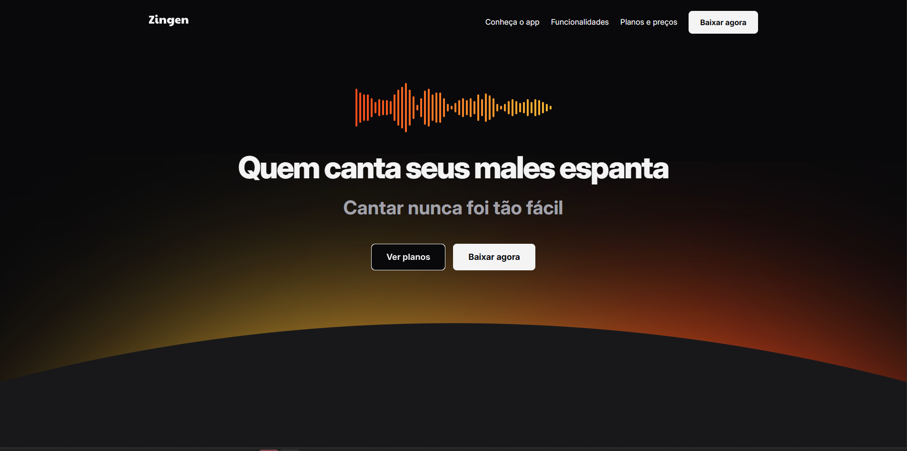
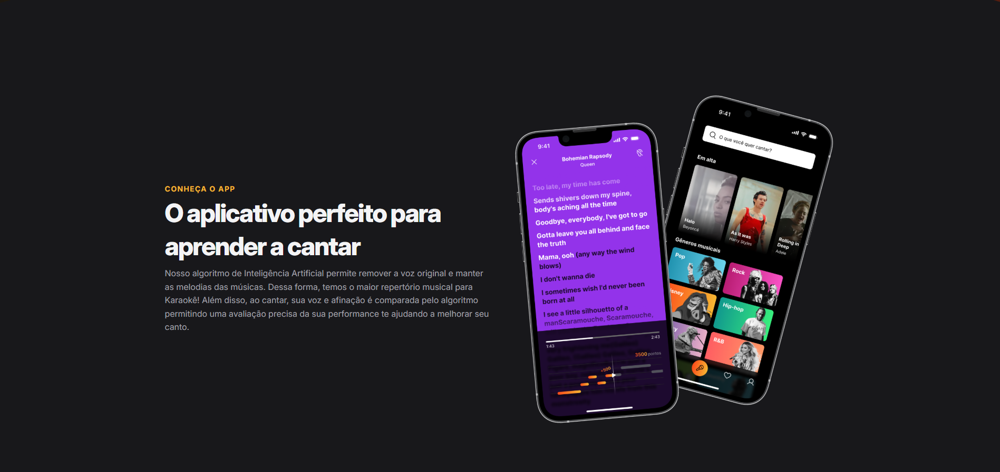
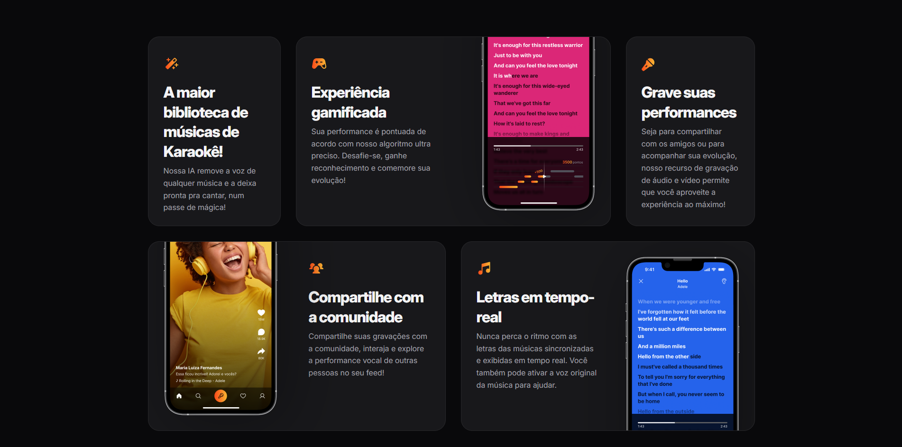
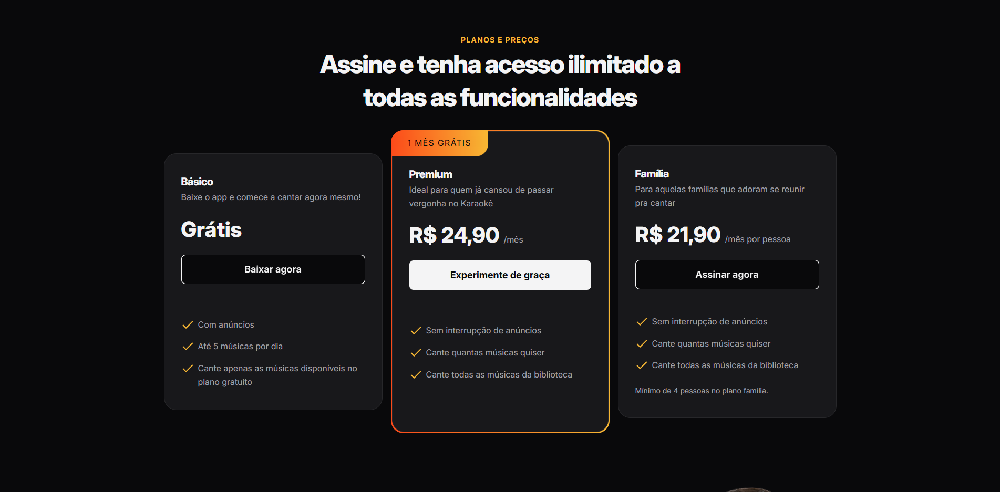
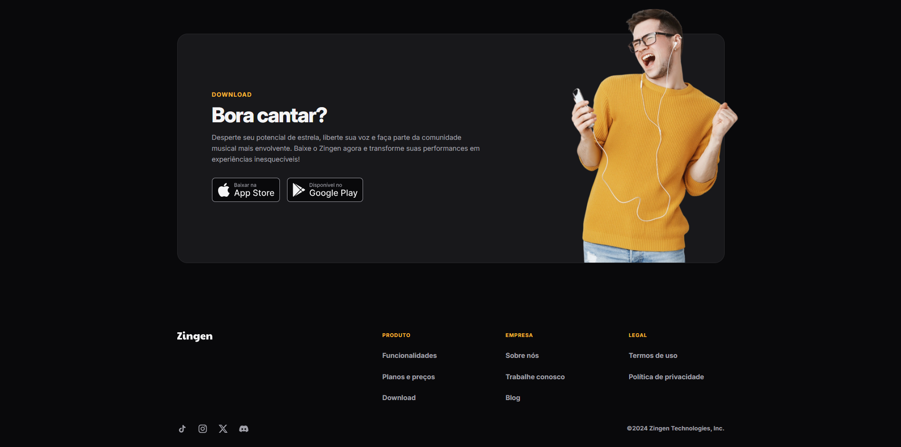

# Zingen — Landing Page de Karaokê

Landing page responsiva para o Zingen, um aplicativo de karaokê que usa inteligência artificial para remover a voz original das músicas e ajudar o usuário a evoluir sua performance.

## Sobre o projeto

O projeto apresenta o conceito do Zingen para pessoas interessadas em cantar, gravar performances e participar de uma comunidade musical. A interface foi construída como um projeto de estudo de HTML e CSS, com foco em responsividade, hierarquia visual e organização modular dos estilos.

## Funcionalidades

- Hero section com chamada principal e ações de navegação.
- Apresentação do aplicativo e de suas funcionalidades.
- Cards com recursos como biblioteca de músicas, gamificação, gravação, comunidade e letras em tempo real.
- Seção de planos Básico, Premium e Família.
- Área de download com botões para App Store e Google Play.
- Layout responsivo para dispositivos móveis e telas maiores.
- Estados de hover e foco visível para melhorar a interação e a acessibilidade.

## Demonstração

Acesse a [versão publicada no GitHub Pages](https://jpfreitas-dev.github.io/zingen-landing-page/).

### Screenshots

<p align="center">
  
  
</p>
<p align="center">
  
  
</p>
<p align="center">
  
</p>

## Tecnologias utilizadas

- HTML5 semântico.
- CSS3.
- CSS Grid e Flexbox para a construção dos layouts.
- Custom Properties para cores, tipografia e espaçamentos.
- Media Queries para adaptação responsiva.
- Google Fonts para a tipografia da interface.
- GitHub Pages para publicação.

Os estilos foram separados por responsabilidade — base global, utilitários, botões, cards, seções, preços, download e rodapé — para facilitar a manutenção do projeto.

## Como executar localmente

### Pré-requisitos

- Um navegador moderno.
- Opcionalmente, uma extensão de servidor local, como Live Server.

### Execução

Clone o repositório e abra o arquivo `index.html` no navegador:

```bash
git clone https://github.com/jpfreitas-dev/zingen-landing-page.git
cd zingen-landing-page
```

Depois, abra `index.html` diretamente ou inicie um servidor local pela extensão Live Server.

Este projeto não possui dependências npm, banco de dados, variáveis de ambiente ou etapa de build.

## Estrutura do projeto

```text
.
├── assets/       # Imagens, ilustrações, logo e ícones
├── styles/       # Folhas de estilo organizadas por responsabilidade
├── index.html    # Estrutura principal da landing page
└── README.md     # Documentação do projeto
```

## Status do projeto

Concluído como projeto de estudo e demonstração visual. A landing page está publicada e pode receber novas melhorias de conteúdo e integração no futuro.

## Próximos passos

- Substituir os links demonstrativos pelos links reais das lojas de aplicativos.
- Conectar os links de redes sociais e páginas institucionais.
- Adicionar uma navegação mobile expansível, caso o menu cresça.
- Validar a interface em mais navegadores e tamanhos de tela.
- Adicionar testes automatizados de acessibilidade e verificação visual.

## Aprendizados

O projeto reforçou a construção de interfaces responsivas com HTML e CSS, especialmente a organização de estilos por módulos, o uso combinado de Grid e Flexbox e a criação de componentes visuais reutilizáveis com Custom Properties.
